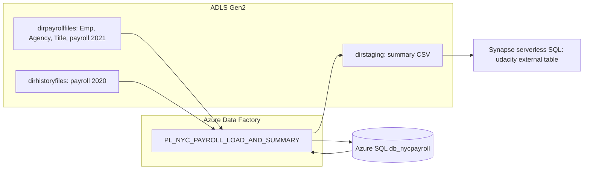

# Architecture

## Pipeline stages
1. Parallel: `DF_LOAD_AGENCY_MASTER`, `DF_LOAD_EMP_MASTER`, `DF_LOAD_TITLE_MASTER`
2. After all succeed, parallel: `DF_LOAD_PAYROLL_2020`, `DF_LOAD_PAYROLL_2021`
3. After both succeed: `DF_PAYROLL_SUMMARY` (parameter `dataflow_param_fiscalyear` <- global `global_param_fiscalyear`)

## DF_PAYROLL_SUMMARY order
Source 2020 -> Select (normalize) -> Source 2021 -> Select (AgencyCode -> AgencyID) -> Union -> Filter (`toInteger(FiscalYear) >= $dataflow_param_fiscalyear`) -> Derived Column (TotalPaid) -> Aggregate (FiscalYear, AgencyName; sum) -> Sinks: Azure SQL `dbo.NYC_Payroll_Summary` (truncate) and ADLS `dirstaging` (clear folder).

## Key decisions
- Serverless SQL only; external table over files; no dedicated pool.
- Managed identity for Synapse access to storage; no secrets in Git.
- Staging output comma-delimited, no header, columns `FiscalYear, AgencyName, TotalPaid`.
- Environment values (storage account, container, SQL server) are placeholders.

## Status
Only SQL scripts and documentation exist (Phase 2). ADF artifacts are planned for Phase 3; nothing is deployed or executed.
